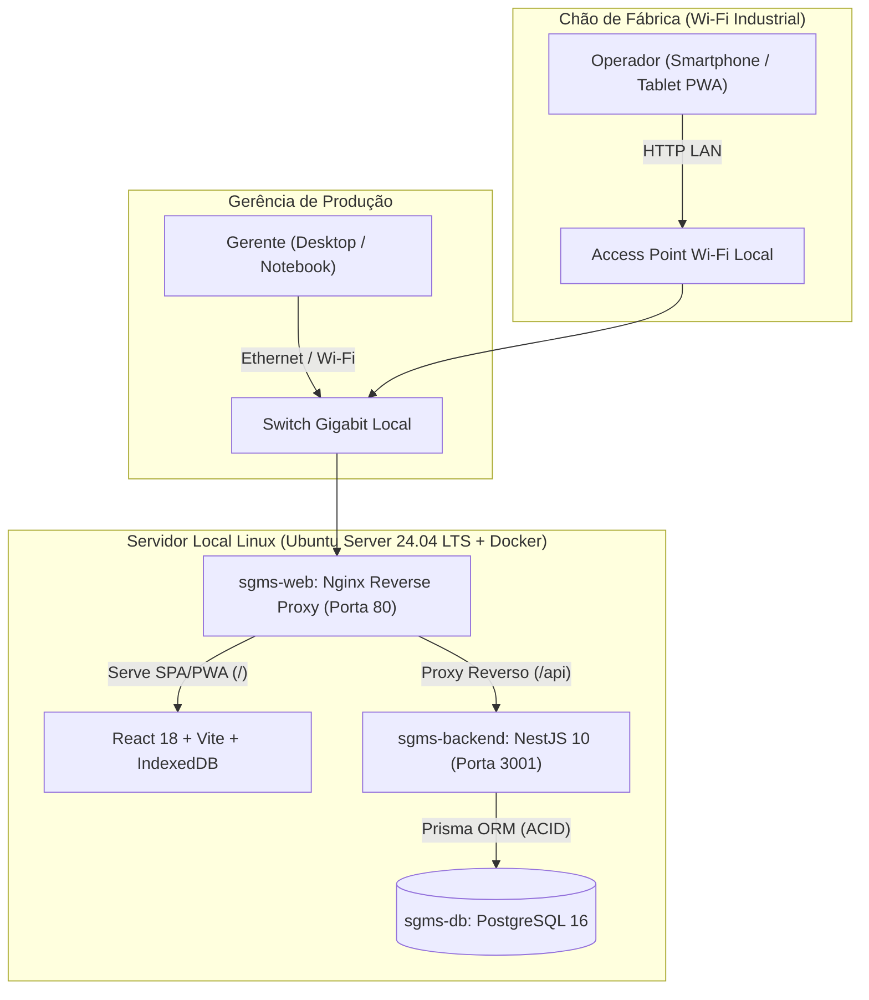

# SGMS — Sistema de Gestão de Máquinas de Sopro (GEPF Agroindústria)

> **Plataforma Industrial On-Premise (Local-First PWA)** para controle de alocação de turnos, apontamento touch de produção de garrafas PET, registro padronizado de paradas de linha, cálculo de disponibilidade OEE e extração de relatórios gerenciais (CSV/PDF) em rede local (LAN).

---

## Sumário

1. [🚀 Como Rodar o Projeto (Passo a Passo Rápido)](#1--como-rodar-o-projeto-passo-a-passo-rápido)
2. [Credenciais de Acesso (Usuários do Seed)](#2-credenciais-de-acesso-usuários-do-seed)
3. [Como Acessar pelo Celular na Mesma Rede Wi-Fi](#3-como-acessar-pelo-celular-na-mesma-rede-wi-fi)
4. [Implantação em Produção no Cliente (Servidor Linux Ubuntu 24.04 LTS + Docker)](#4-implantação-em-produção-no-cliente-servidor-linux-ubuntu-2404-lts--docker)
5. [Visão Geral, Arquitetura e Regras de Negócio](#5-visão-geral-arquitetura-e-regras-de-negócio)
6. [Documentação Técnica Completa (`docs/`)](#6-documentação-técnica-completa-docs)
7. [Comandos Úteis (Testes, Build, Backup e Manutenção)](#7-comandos-úteis-testes-build-backup-e-manutenção)

---

## 1. 🚀 Como Rodar o Projeto (Passo a Passo Rápido)

### Pré-requisitos
- **Node.js 20 LTS** (`v20+`) e **npm**
- **PostgreSQL 16** (via Docker ou instalado localmente)

---

### Passo 1: Subir o Banco de Dados PostgreSQL (Desenvolvimento)
O arquivo [`backend/.env.example`](file:///home/ferreito/SGMS/backend/.env.example) já vem pré-configurado para conectar na porta **`5434`** com usuário `sgms_admin`, senha `sgms_secret_2026` e banco `sgms_db`.

Para subir o banco rapidamente via Docker:
```bash
docker run --name sgms-postgres-dev \
  -e POSTGRES_USER=sgms_admin \
  -e POSTGRES_PASSWORD=sgms_secret_2026 \
  -e POSTGRES_DB=sgms_db \
  -p 5434:5432 \
  -d postgres:16-alpine
```
*(Caso o container já exista e esteja parado, basta rodar `docker start sgms-postgres-dev`).*

---

### Passo 2: Rodar o Backend (Terminal 1)
Abra um terminal na raiz do projeto e execute:
```bash
cd backend

# 1. Copie o arquivo de variáveis de ambiente (se ainda não existir)
cp -n .env.example .env

# 2. Instale as dependências e gere o Prisma Client
npm install
npx prisma generate

# 3. Crie as tabelas no banco e popule os dados iniciais (usuários, máquinas, turnos e histórico de 30 dias)
npx prisma migrate deploy
npx prisma db seed

# 4. Inicie o servidor Backend em modo watch (porta 3001)
npm run start:dev
```
Você verá no terminal: `SGMS Backend em execução na porta 3001 (0.0.0.0) com prefixo /api`.

---

### Passo 3: Rodar o Frontend (Terminal 2)
Abra um **segundo terminal** na raiz do projeto e execute:
```bash
cd frontend

# 1. Copie o arquivo de variáveis de ambiente (já configurado com VITE_API_URL=/api)
cp -n .env.example .env

# 2. Instale as dependências
npm install

# 3. Inicie o servidor Vite (porta 5173)
npm run dev
```

Pronto! Abra no navegador do computador:
- **URL Local:** `http://localhost:5173`

---

## 2. Credenciais de Acesso (Usuários do Seed)

Ao rodar `npx prisma db seed`, o sistema cria automaticamente os turnos, 4 sopradoras (`SOPRO-01` a `SOPRO-04`) e as contas abaixo:

| Perfil | Usuário (`username`) | Senha | Tela Inicial após Login |
| :--- | :--- | :--- | :--- |
| **GERENTE** | `admin` | `admin123` | Dashboard Gerencial (`/admin/dashboard`) |
| **OPERADOR** | `operador1` | `operador123` | Chão de Fábrica (`/chao-de-fabrica/alocacao`) |
| **OPERADOR** | `operador2` | `operador123` | Chão de Fábrica (`/chao-de-fabrica/alocacao`) |
| **OPERADOR** | `operador3` | `operador123` | Chão de Fábrica (`/chao-de-fabrica/alocacao`) |

---

## 3. Como Acessar pelo Celular na Mesma Rede Wi-Fi

O projeto já está configurado com `VITE_API_URL=/api` e proxy reverso automático no [`frontend/vite.config.ts`](file:///home/ferreito/SGMS/frontend/vite.config.ts). Ou seja, **você nunca precisa editar arquivos `.env` com IP**, pois o próprio Vite na porta `5173` encaminha `/api` para o backend na porta `3001`.

### Se você estiver no Linux Nativo:
1. Descubra o IP do seu PC no Wi-Fi rodando:
   ```bash
   hostname -I | awk '{print $1}'
   ```
2. No celular (conectado no mesmo Wi-Fi), acesse `http://<IP_DO_PC>:5173`.

### Se você estiver no Windows usando WSL2:
Como o WSL2 roda em uma rede interna do Windows, abra o **PowerShell (como Administrador)** no Windows e execute:
```powershell
$wslIp = (wsl -e sh -c "hostname -I | awk '{print `$1}'").Trim()
netsh interface portproxy reset
netsh interface portproxy add v4tov4 listenport=5173 listenaddress=0.0.0.0 connectport=5173 connectaddress=$wslIp
Remove-NetFirewallRule -DisplayName "SGMS Vite LAN" -ErrorAction SilentlyContinue
New-NetFirewallRule -DisplayName "SGMS Vite LAN" -Direction Inbound -LocalPort 5173 -Protocol TCP -Action Allow -Profile Any

$wifiIp = (Get-NetIPAddress -AddressFamily IPv4 | Where-Object { $_.InterfaceAlias -match "Wi-Fi|Ethernet" -and $_.IPAddress -notlike "169.*" } | Select-Object -First 1).IPAddress
Write-Host "`nAcesse no navegador do celular: http://${wifiIp}:5173`n" -ForegroundColor Green
```

---

## 4. Implantação em Produção no Cliente (Servidor Linux Ubuntu 24.04 LTS + Docker)

Para o servidor físico/mini-PC da fábrica, recomenda-se **Ubuntu Server 24.04 LTS** (ou **Debian 12 Bookworm**). Em produção, o sistema roda via **Docker Compose** na **porta `80` padrão** (sem precisar digitar `:5173` na URL) e reinicia sozinho caso falte energia na fábrica (`restart: unless-stopped`).

### Passo 1: Instalar Docker e Avahi (mDNS) no Ubuntu Server 24.04 LTS
```bash
sudo apt update && sudo apt upgrade -y
sudo apt install -y ca-certificates curl gnupg git avahi-daemon
curl -fsSL https://get.docker.com | sudo sh
sudo usermod -aG docker $USER
newgrp docker
```

### Passo 2: Configurar Nome Fixo (`http://sgms.local`) e IP Estático na Rede da Fábrica
1. **Ativar endereço `http://sgms.local`:**
   ```bash
   sudo hostnamectl set-hostname sgms
   sudo systemctl enable --now avahi-daemon
   ```
2. **Fixar o IP do servidor no Netplan (ex: `192.168.1.200`):**
   Edite `/etc/netplan/50-cloud-init.yaml` (ou o arquivo `.yaml` existente em `/etc/netplan/`):
   ```yaml
   network:
     version: 2
     ethernets:
       eth0: # Substitua pelo nome da placa de rede vista no comando 'ip a' (ex: enp3s0)
         dhcp4: false
         addresses:
           - 192.168.1.200/24
         routes:
           - to: default
             via: 192.168.1.1
         nameservers:
           addresses: [192.168.1.1, 8.8.8.8]
   ```
   Aplique com:
   ```bash
   sudo netplan apply
   ```

### Passo 3: Configurar o `.env` de Produção e Subir com 1 Comando (O Docker instala tudo sozinho)
> **Nota importante:** Usando Docker Compose, você **não precisa instalar Node.js, PostgreSQL ou Nginx na máquina da empresa**, nem rodar `npm install` manualmente. O próprio comando `docker compose up -d --build` executa o [`backend/Dockerfile`](file:///home/ferreito/SGMS/backend/Dockerfile) e o [`frontend/Dockerfile`](file:///home/ferreito/SGMS/frontend/Dockerfile), que baixam o Node 20, instalam todas as dependências (`npm ci`), geram o Prisma Client e compilam o projeto automaticamente dentro dos containers. *(Apenas durante esse primeiro build de instalação o PC precisará de internet por ~2 minutos para baixar os pacotes; depois disso, pode operar 100% sem internet).*

```bash
git clone <URL_DO_REPOSITORIO> /opt/sgms
cd /opt/sgms

# Copie o template de produção e defina senhas fortes para POSTGRES_PASSWORD e JWT_SECRET
cp .env.production.example .env
nano .env

# Construa e inicie os 3 containers (sgms-db, sgms-backend e sgms-web) em background
docker compose up -d --build
```

### Passo 4: Popular Dados Iniciais (Opcional — Apenas na 1ª Instalação)
```bash
docker compose exec sgms-backend npx prisma db seed
```

Em produção, os operadores e o gerente acessam direto no navegador:
- **`http://192.168.1.200`** *(IP fixo do servidor Linux na porta 80 — sem `:5173`)*
- **`http://sgms.local`** *(Nome mDNS na rede local)*

---

## 5. Visão Geral, Arquitetura e Regras de Negócio



| Camada | Tecnologia | Papel na Arquitetura |
| :--- | :--- | :--- |
| **Backend** | NestJS 10 + TypeScript Estrito | API RESTful modular (`/api`), validação estrita via `class-validator`, Guards RBAC (`GERENTE`, `OPERADOR`) e respostas de erro padronizadas segundo **RFC 7807** (`application/problem+json`). |
| **ORM & Banco** | Prisma ORM + PostgreSQL 16 | Transações interativas ACID (`prisma.$transaction`), lock pessimista (`SELECT ... FOR UPDATE`) para exclusividade física 1:1 de sopradora e índice único condicional para alocações `ACTIVE`. |
| **Frontend** | React 18 + Vite + Tailwind + shadcn/ui | SPA/PWA responsiva com `react-hook-form` + `Zod`, gráficos de Pareto em `Recharts` e persistência offline via `idb` (`IndexedDB`). |
| **Relatórios** | Fast-CSV + PDFKit | Exportação analítica em streaming binário de arquivos CSV (UTF-8 com BOM, delimitador `;`) e relatórios executivos em PDF. |
| **Infraestrutura** | Docker Compose + Nginx 1.27 Alpine | Empacotamento multi-stage com reinício automático (`restart: unless-stopped`), compressão `gzip` e aplicação automática de migrations no boot. |

### Regras de Domínio Fundamentais
- **`RN-01` (Exclusividade Física 1:1):** Uma sopradora física (`IDLE`) só pode ter **uma única alocação `ACTIVE`** por vez, e cada operador só pode operar uma máquina por vez.
- **`RN-02` & `RN-04` (Validação na Fronteira & Zero Fallback):** Quantidades devem ser inteiros estritamente positivos ($Q \ge 1$). Paradas com motivo `OUTROS` exigem justificativa textual detalhada ($\ge 5$ caracteres).
- **`RN-09` (Travamento Temporal):** Apontamentos de produção e inícios de parada em tempo real têm o carimbo de data/hora travado no instante da confirmação. Apenas lançamentos de parada em modo **Retroativo** permitem edição manual de início e término.
- **`RN-10` (Segregação OEE de Pausa Planejada):** Paradas pelo motivo `REFEICAO_INTERVALO` (`"Refeição / Intervalo"`) são deduzidas do Tempo Planejado do Turno ($T_{\text{disp\_turno}} = \max(0, T_{\text{planejado}} - T_{\text{pausa\_planejada}})$) e excluídas do Gráfico de Pareto de gargalos produtivos.

---

## 6. Documentação Técnica Completa (`docs/`)

Toda a especificação técnica e histórica do projeto encontra-se em [`docs/`](file:///home/ferreito/SGMS/docs):

- [`docs/00-visao-e-post-mortems.md`](file:///home/ferreito/SGMS/docs/00-visao-e-post-mortems.md) — Visão do produto, limites do MVP e autópsia de sistemas industriais.
- [`docs/01-requisitos.md`](file:///home/ferreito/SGMS/docs/01-requisitos.md) — Requisitos Funcionais (`RF-01` a `RF-11`) e Não-Funcionais (`RNF-01` a `RNF-07`).
- [`docs/02-regras-de-negocio.md`](file:///home/ferreito/SGMS/docs/02-regras-de-negocio.md) — Invariantes de domínio (`RN-01` a `RN-10`), enums SSOT e fórmulas de OEE.
- [`docs/03-fluxos.md`](file:///home/ferreito/SGMS/docs/03-fluxos.md) — Fluxogramas operacionais, máquinas de estado e sincronização offline.
- [`docs/04-modelo-de-dados.md`](file:///home/ferreito/SGMS/docs/04-modelo-de-dados.md) — Modelo Entidade-Relacionamento, constraints e índices PostgreSQL.
- [`docs/05-arquitetura.md`](file:///home/ferreito/SGMS/docs/05-arquitetura.md) — Topologia de rede local LAN, contrato RFC 7807 e estrutura modular.
- [`docs/06-auditoria-bugs-e-inconsistencias.md`](file:///home/ferreito/SGMS/docs/06-auditoria-bugs-e-inconsistencias.md) — Registro de auditoria e saneamento de bugs críticos.
- [`docs/roadmap/ROADMAP-GERAL.md`](file:///home/ferreito/SGMS/docs/roadmap/ROADMAP-GERAL.md) — Roadmap macro de todas as fases do projeto (Fases 1 a 7).

---

## 7. Comandos Úteis (Testes, Build, Backup e Manutenção)

### Rodar Testes e Build de Validação (Desenvolvimento)
```bash
# Compilar e rodar testes unitários do Backend
npm --prefix backend run build
npm --prefix backend test

# Compilar o Frontend (TypeScript + Vite PWA Build)
npm --prefix frontend run build
```

### Operação Docker em Produção (Logs, Backup e Atualização)
```bash
# Ver status dos containers e logs da API em tempo real
docker compose ps
docker compose logs -f sgms-backend

# Gerar Backup Completo do Banco de Dados PostgreSQL
docker compose exec -T sgms-db pg_dump -U sgms_admin -d sgms_db > backup_sgms_$(date +%Y-%m-%d_%H%M).sql

# Restaurar um Backup do Banco de Dados
cat backup_sgms_2026-10-31.sql | docker compose exec -T sgms-db psql -U sgms_admin -d sgms_db

# Atualizar o sistema quando houver nova versão no Git (sem perder dados do banco)
git pull
docker compose up -d --build
```

