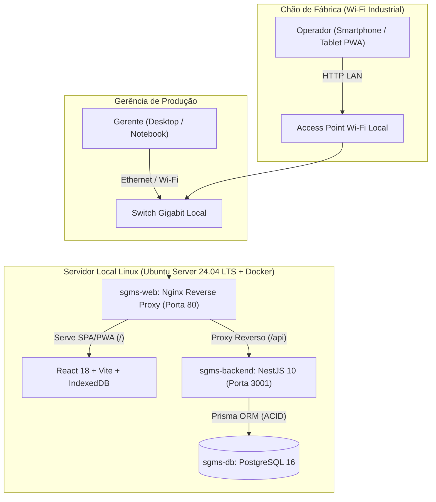

# SGMS — Sistema de Gestão de Máquinas de Sopro (GEPF Agroindústria)

> **Plataforma Industrial On-Premise (Local-First PWA)** para controle de alocação de turnos, apontamento touch de produção de garrafas PET, registro padronizado de paradas de linha, cálculo de disponibilidade OEE e extração de relatórios gerenciais (CSV/PDF) em rede local (LAN).

---

## Sumário

1. [Visão Geral e Arquitetura On-Premise](#1-visão-geral-e-arquitetura-on-premise)
2. [Stack Tecnológica e Regras de Domínio](#2-stack-tecnológica-e-regras-de-domínio)
3. [Documentação Técnica (Fonte Primária da Verdade — SSOT)](#3-documentação-técnica-fonte-primária-da-verdade--ssot)
4. [Guia de Desenvolvimento Local (PC / WSL2 + Celular no Wi-Fi)](#4-guia-de-desenvolvimento-local-pc--wsl2--celular-no-wi-fi)
5. [Implantação em Produção no Cliente (Servidor Linux Ubuntu 24.04 LTS)](#5-implantação-em-produção-no-cliente-servidor-linux-ubuntu-2404-lts)
6. [Credenciais Iniciais (Seed de Homologação)](#6-credenciais-iniciais-seed-de-homologação)
7. [Operação, Backup e Manutenção em Produção](#7-operação-backup-e-manutenção-em-produção)

---

## 1. Visão Geral e Arquitetura On-Premise

O **SGMS** foi projetado para operar **100% dentro da rede local (LAN)** da planta industrial da GEPF Agroindústria, sem depender de conectividade com a internet pública.



### Diferenciais Operacionais para Chão de Fábrica
- **Tolerância Offline (Local-First Buffer via IndexedDB):** Todo apontamento de garrafas ou parada de linha gera um `clientUuid` (UUID v4 compatível com LAN HTTP via `crypto.getRandomValues`) e é gravado imediatamente no `IndexedDB` do aparelho. Caso o sinal de Wi-Fi oscile no galpão, os dados permanecem salvos no dispositivo e sincronizam automaticamente em lote (`POST /api/sync/batch`) com garantia de idempotência transacional assim que a conexão retorna.
- **Ergonomia Industrial Touch:** Alvos de toque $\ge 44 \times 44\text{px}$, teclado numérico nativo (`inputMode="numeric"`), inputs numéricos puros (sem setas incrementais ou botões de soma que induzam a erro) e gavetas deslizantes (`Sheet`).
- **Exposição Unificada na Porta `80`:** Em produção, o Nginx entrega o aplicativo web e encaminha `/api` internamente para o backend, permitindo acesso direto via `http://sgms.local` ou `http://<IP_FIXO>` sem digitar portas.

---

## 2. Stack Tecnológica e Regras de Domínio

| Camada | Tecnologia | Papel na Arquitetura |
| :--- | :--- | :--- |
| **Backend** | NestJS 10 + TypeScript Estrito | API RESTful modular (`/api`), validação estrita via `class-validator`, Guards RBAC (`GERENTE`, `OPERADOR`) e respostas de erro padronizadas segundo **RFC 7807** (`application/problem+json`). |
| **ORM & Banco** | Prisma ORM + PostgreSQL 16 | Transações interativas ACID (`prisma.$transaction`), lock pessimista (`SELECT ... FOR UPDATE`) para exclusividade física 1:1 de sopradora e índice único condicional para alocações `ACTIVE`. |
| **Frontend** | React 18 + Vite + Tailwind + shadcn/ui | SPA/PWA responsiva com `react-hook-form` + `Zod`, gráficos de Pareto em `Recharts` e persistência offline via `idb`. |
| **Relatórios** | Fast-CSV + PDFKit | Exportação analítica em streaming binário de arquivos CSV (UTF-8 com BOM, delimitador `;`) e relatórios executivos em PDF. |
| **Infraestrutura** | Docker Compose + Nginx 1.27 Alpine | Empacotamento multi-stage com reinício automático (`restart: unless-stopped`), compressão `gzip` e aplicação automática de migrations no boot. |

### Principais Regras de Negócio Implementadas
- **`RN-01` (Exclusividade Física 1:1):** Uma sopradora física (`IDLE`) só pode ter **uma única alocação `ACTIVE`** por vez, e cada operador só pode operar uma máquina por vez. Tentativas concorrentes retornam `HTTP 409 Conflict (MACHINE_ALREADY_ALLOCATED)`.
- **`RN-02` & `RN-04` (Validação na Fronteira & Zero Fallback):** Quantidades devem ser inteiros estritamente positivos ($Q \ge 1$). Paradas com motivo `OUTROS` exigem justificativa textual detalhada ($\ge 5$ caracteres). Campos opcionais não informados são persistidos como `null` estrito.
- **`RN-09` (Travamento Temporal):** Apontamentos de produção e inícios de parada em tempo real têm o carimbo de data/hora travado no instante da confirmação. Apenas lançamentos de parada em modo **Retroativo** permitem edição manual de início e término.
- **`RN-10` (Segregação OEE de Pausa Planejada):** Paradas pelo motivo `REFEICAO_INTERVALO` (`"Refeição / Intervalo"`) são deduzidas do Tempo Planejado do Turno ($T_{\text{disp\_turno}} = \max(0, T_{\text{planejado}} - T_{\text{pausa\_planejada}})$) e excluídas do Gráfico de Pareto de gargalos produtivos.

---

## 3. Documentação Técnica (Fonte Primária da Verdade — SSOT)

Toda a especificação técnica e histórica do projeto encontra-se em [`docs/`](file:///home/ferreito/SGMS/docs):

- [`docs/00-visao-e-post-mortems.md`](file:///home/ferreito/SGMS/docs/00-visao-e-post-mortems.md) — Visão do produto, limites do MVP e autópsia de sistemas industriais.
- [`docs/01-requisitos.md`](file:///home/ferreito/SGMS/docs/01-requisitos.md) — Requisitos Funcionais (`RF-01` a `RF-11`) e Não-Funcionais (`RNF-01` a `RNF-07`).
- [`docs/02-regras-de-negocio.md`](file:///home/ferreito/SGMS/docs/02-regras-de-negocio.md) — Invariantes de domínio (`RN-01` a `RN-10`), enums SSOT e fórmulas de OEE.
- [`docs/03-fluxos.md`](file:///home/ferreito/SGMS/docs/03-fluxos.md) — Fluxogramas operacionais, máquinas de estado e sincronização offline.
- [`docs/04-modelo-de-dados.md`](file:///home/ferreito/SGMS/docs/04-modelo-de-dados.md) — Modelo Entidade-Relacionamento, constraints e índices PostgreSQL.
- [`docs/05-arquitetura.md`](file:///home/ferreito/SGMS/docs/05-arquitetura.md) — Topologia de rede local LAN, contrato RFC 7807 e estrutura modular.
- [`docs/06-auditoria-bugs-e-inconsistencias.md`](file:///home/ferreito/SGMS/docs/06-auditoria-bugs-e-inconsistencias.md) — Registro de auditoria e saneamento de bugs críticos.
- [`docs/roadmap/ROADMAP-GERAL.md`](file:///home/ferreito/SGMS/docs/roadmap/ROADMAP-GERAL.md) — Roadmap macro de todas as fases do projeto (Fases 1 a 7).

---

## 4. Guia de Desenvolvimento Local (PC / WSL2 + Celular no Wi-Fi)

### 4.1 Pré-requisitos
- **Node.js 20 LTS** (`v20.x`) e **npm**
- **PostgreSQL 16** (rodando localmente ou via container Docker de desenvolvimento)

### 4.2 Configuração e Inicialização do Backend
```bash
cd backend
cp .env.example .env
# Ajuste DATABASE_URL no arquivo backend/.env conforme seu PostgreSQL local

npm install
npx prisma migrate deploy
npx prisma db seed
npm run start:dev
```
O Backend subirá em `http://0.0.0.0:3001/api`.

### 4.3 Configuração e Inicialização do Frontend
O Frontend já está pré-configurado com `VITE_API_URL=/api` e proxy reverso no [`frontend/vite.config.ts`](file:///home/ferreito/SGMS/frontend/vite.config.ts), funcionando automaticamente em `localhost` ou qualquer IP da rede local sem necessidade de alterar arquivos `.env`:

```bash
cd frontend
cp .env.example .env
npm install
npm run dev
```
O Frontend estará acessível no computador em `http://localhost:5173`.

### 4.4 Como Testar pelo Celular na Mesma Rede Wi-Fi (Ambiente Windows + WSL2)
Caso esteja rodando o ambiente de desenvolvimento dentro do **WSL2 no Windows**, execute uma única vez no **PowerShell (como Administrador)** para abrir a ponte da porta `5173` para o Wi-Fi:

```powershell
$wslIp = (wsl -e sh -c "hostname -I | awk '{print `$1}'").Trim()
netsh interface portproxy reset
netsh interface portproxy add v4tov4 listenport=5173 listenaddress=0.0.0.0 connectport=5173 connectaddress=$wslIp
Remove-NetFirewallRule -DisplayName "SGMS Vite LAN" -ErrorAction SilentlyContinue
New-NetFirewallRule -DisplayName "SGMS Vite LAN" -Direction Inbound -LocalPort 5173 -Protocol TCP -Action Allow -Profile Any

$wifiIp = (Get-NetIPAddress -AddressFamily IPv4 | Where-Object { $_.InterfaceAlias -match "Wi-Fi|Ethernet" -and $_.IPAddress -notlike "169.*" } | Select-Object -First 1).IPAddress
Write-Host "Acesse no celular: http://${wifiIp}:5173" -ForegroundColor Green
```

---

## 5. Implantação em Produção no Cliente (Servidor Linux Ubuntu 24.04 LTS)

Para o servidor físico/mini-PC da fábrica, recomenda-se **Ubuntu Server 24.04 LTS** (ou **Debian 12 Bookworm**). No Linux nativo não existe camada virtual WSL2: os containers escutam diretamente na placa de rede física na **porta `80` padrão**.

### Passo 1: Instalar Docker e Docker Compose no Ubuntu Server 24.04 LTS
```bash
sudo apt update && sudo apt upgrade -y
sudo apt install -y ca-certificates curl gnupg git avahi-daemon
curl -fsSL https://get.docker.com | sudo sh
sudo usermod -aG docker $USER
newgrp docker
```

### Passo 2: Configurar Nome Fixo (`http://sgms.local`) e IP Estático na Rede da Fábrica
1. **Definir o hostname mDNS (`sgms.local`):**
   ```bash
   sudo hostnamectl set-hostname sgms
   sudo systemctl enable --now avahi-daemon
   ```
2. **Fixar o IP do servidor no Netplan (ex: `192.168.1.200`):**
   Edite `/etc/netplan/50-cloud-init.yaml` (ou o arquivo existente em `/etc/netplan/`):
   ```yaml
   network:
     version: 2
     ethernets:
       eth0: # Substitua pelo nome da sua placa vista no comando 'ip a' (ex: enp3s0)
         dhcp4: false
         addresses:
           - 192.168.1.200/24
         routes:
           - to: default
             via: 192.168.1.1
         nameservers:
           addresses: [192.168.1.1, 8.8.8.8]
   ```
   Aplique com:
   ```bash
   sudo netplan apply
   ```

### Passo 3: Clonar o Projeto e Configurar Variáveis de Produção
```bash
git clone <URL_DO_REPOSITORIO> /opt/sgms
cd /opt/sgms
cp .env.production.example .env
nano .env
```
No arquivo `.env`, defina uma senha forte para `POSTGRES_PASSWORD` e uma chave aleatória forte para `JWT_SECRET` (você pode gerar uma com `openssl rand -hex 32`).

### Passo 4: Subir toda a Infraestrutura com 1 Comando
```bash
docker compose up -d --build
```
O que acontece automaticamente:
1. O container `sgms-db` (PostgreSQL 16) inicializa o banco e aguarda ficar saudável (`healthcheck`).
2. O container `sgms-backend` executa automaticamente `prisma migrate deploy` criando todas as tabelas e sobe a API na porta interna `3001`.
3. O container `sgms-web` (Nginx) sobe na **porta `80`** servindo o frontend otimizado e fazendo proxy reverso de `/api`.

### Passo 5: Popular os Cadastros Iniciais (Apenas na 1ª Instalação)
Se desejar criar o usuário Gerente inicial e os turnos/máquinas padrão do seed:
```bash
docker compose exec sgms-backend npx prisma db seed
```

Pronto! Qualquer celular, tablet ou computador conectado ao Wi-Fi/rede da fábrica pode acessar diretamente:
- **`http://192.168.1.200`** *(IP fixo do servidor — não precisa digitar `:5173`)*
- **`http://sgms.local`** *(Nome mDNS em dispositivos compatíveis)*

---

## 6. Credenciais Iniciais (Seed de Homologação)

Ao executar `npx prisma db seed`, as seguintes contas ficam disponíveis para acesso:

| Perfil | Usuário (`username`) | Senha | Rota Inicial |
| :--- | :--- | :--- | :--- |
| **GERENTE** | `admin` | `admin123` | `/admin/dashboard` |
| **OPERADOR** | `operador1` | `operador123` | `/chao-de-fabrica/alocacao` |
| **OPERADOR** | `operador2` | `operador123` | `/chao-de-fabrica/alocacao` |
| **OPERADOR** | `operador3` | `operador123` | `/chao-de-fabrica/alocacao` |

---

## 7. Operação, Backup e Manutenção em Produção

### Verificar Status dos Containers e Logs em Tempo Real
```bash
docker compose ps
docker compose logs -f sgms-backend
```

### Realizar Backup Completo do Banco de Dados PostgreSQL
```bash
docker compose exec -T sgms-db pg_dump -U sgms_admin -d sgms_db > backup_sgms_$(date +%Y-%m-%d_%H%M).sql
```

### Restaurar um Backup do Banco de Dados
```bash
cat backup_sgms_2026-10-31.sql | docker compose exec -T sgms-db psql -U sgms_admin -d sgms_db
```

### Atualizar o Sistema no Cliente após Nova Versão no Git
```bash
cd /opt/sgms
git pull
docker compose up -d --build
```
*(As migrações de banco são aplicadas automaticamente na subida do `sgms-backend` sem perda dos dados existentes no volume `sgms_pgdata`).*

