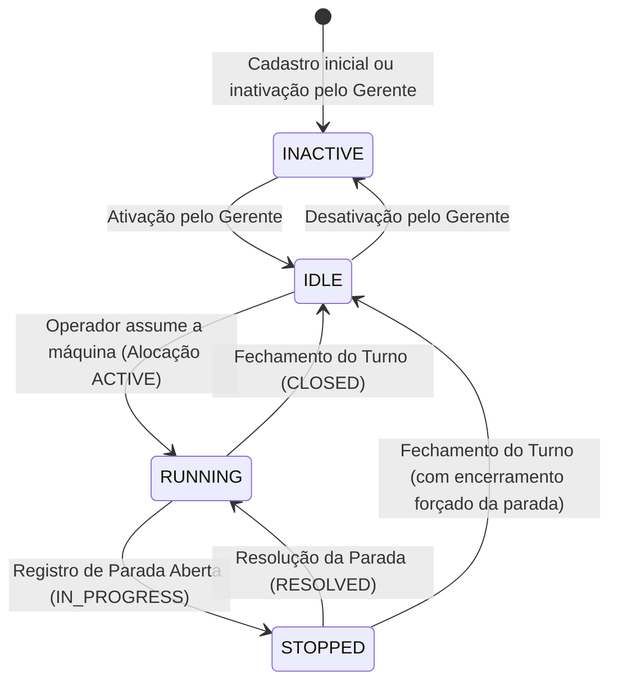
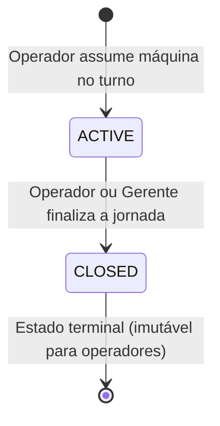
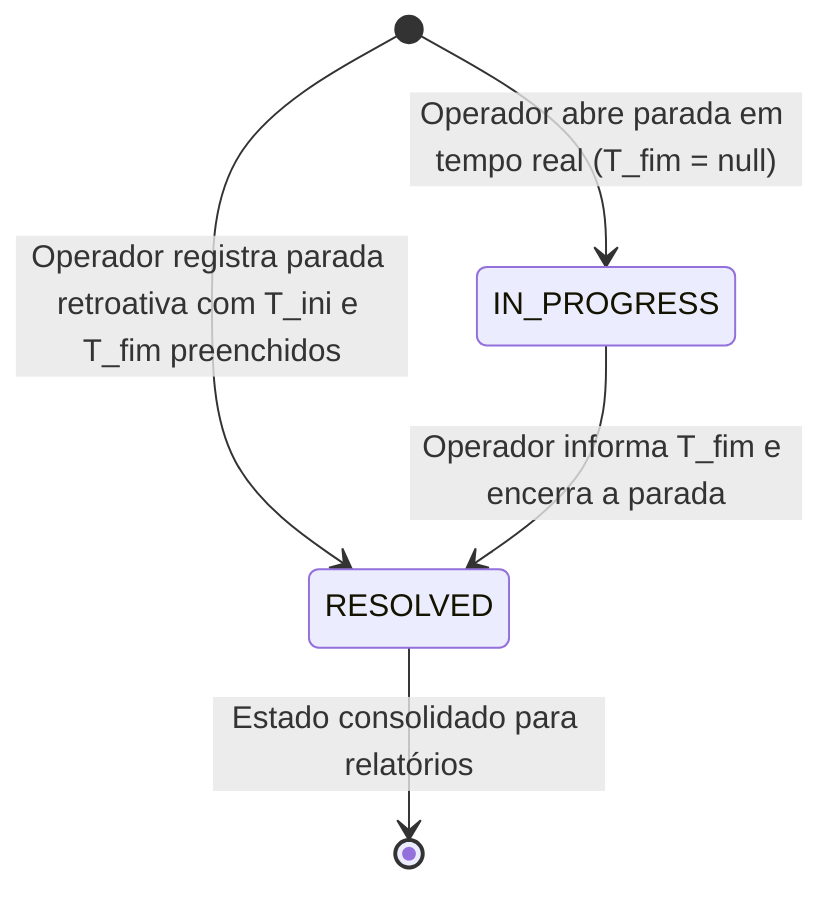

# SGMS — Sistema de Gestão de Máquinas de Sopro
## `docs/02-regras-de-negocio.md`

---

### 1. Dicionário de Enums e Estados Globais (SSOT)

Todos os estados, papéis e categorias do SGMS são centralizados sem o uso de strings mágicas ou literais dispersos:

```typescript
export enum UserRole {
  GERENTE = 'GERENTE',
  OPERADOR = 'OPERADOR',
}

export enum MachineStatus {
  INACTIVE = 'INACTIVE', // Máquina desativada ou fora de operação pela gerência
  IDLE = 'IDLE',         // Máquina ativa no sistema, mas sem operador alocado no turno
  RUNNING = 'RUNNING',   // Máquina alocada em turno e em processo de sopro
  STOPPED = 'STOPPED',   // Máquina paralisada com ocorrência de parada em andamento
}

export enum ShiftAllocationStatus {
  ACTIVE = 'ACTIVE', // Turno em andamento com operador alocado na máquina
  CLOSED = 'CLOSED', // Turno finalizado pelo operador ou gerente (imutável para novas inserções)
}

export enum DowntimeReason {
  PRE_FORMA = 'PRE_FORMA',                 // Falta ou defeito físico de pré-formas PET (Parada Não Planejada)
  COMPRESSOR = 'COMPRESSOR',               // Queda de pressão ou falha no compressor de alta pressão (Parada Não Planejada)
  AQUECIMENTO_FORNO = 'AQUECIMENTO_FORNO', // Desvio térmico nas lâmpadas ou túnel de aquecimento (Parada Não Planejada)
  MOLDE = 'MOLDE',                         // Troca, ajuste mecânico ou vazamento no molde de sopro (Parada Não Planejada)
  MECANICA = 'MECANICA',                   // Falha mecânica em correntes, pinças ou esteiras (Parada Não Planejada)
  ELETRICA = 'ELETRICA',                   // Desarme elétrico, sensores, inversor ou CLP (Parada Não Planejada)
  REFEICAO_INTERVALO = 'REFEICAO_INTERVALO', // Pausa planejada para almoço/refeição ou intervalo intrajornada (Parada Planejada)
  OUTROS = 'OUTROS',                       // Qualquer outro motivo não planejado (exige justificativa obrigatória)
}

export enum DowntimeStatus {
  IN_PROGRESS = 'IN_PROGRESS', // Parada aberta em tempo real (sem data/hora fim)
  RESOLVED = 'RESOLVED',       // Parada com início e fim consolidados e duração calculada
}
```

---

### 2. Invariantes Inegociáveis de Domínio (RN)

| ID | Nome da Regra | Invariante Lógica & Validação | Tratamento de Violação |
| :--- | :--- | :--- | :--- |
| **RN-01** | **Exclusividade de Alocação (1:1)** | Uma máquina de sopro só pode ter no máximo **uma** alocação com status `ACTIVE` em um mesmo turno e data. Nenhum outro operador pode assumir a mesma máquina enquanto a alocação anterior não estiver `CLOSED`. | HTTP 409 Conflict: `"Máquina já possui alocação ativa neste turno por outro operador."` |
| **RN-02** | **Integridade da Quantidade Produzida** | A contagem de garrafas sopradas deve ser um número inteiro estritamente positivo: $Q \in \mathbb{N}, Q \ge 1$. Proibido valor zero, negativo, fracionário ou substitutos artificiais. | HTTP 422 Unprocessable Entity: `"Quantidade de garrafas deve ser um número inteiro maior que zero."` |
| **RN-03** | **Consistência Cronológica de Paradas** | Toda parada com timestamp de início ($T_{ini}$) e fim ($T_{fim}$) deve satisfazer: $T_{fim} \ge T_{ini}$. A duração em minutos é calculada como $\Delta t = \lfloor (T_{fim} - T_{ini}) / 60000 \rfloor$. Proibido $\Delta t < 0$. | HTTP 422 Unprocessable Entity: `"O horário de término da parada não pode ser anterior ao horário de início."` |
| **RN-04** | **Justificativa Obrigatória para "Outros"** | Se `reason == DowntimeReason.OUTROS`, o campo `justification` torna-se obrigatório com tamanho mínimo de 5 caracteres (`justification.trim().length >= 5`). Se `reason != OUTROS`, o campo `justification` propaga estritamente como `null`. | HTTP 400 Bad Request: `"A justificativa detalhada é obrigatória para paradas com motivo OUTROS (mínimo de 5 caracteres)."` |
| **RN-05** | **Bloqueio de Carimbo Futuro e Janela Temporal** | Todo timestamp informado ($T_{evento}$) deve satisfazer: $T_{evento} \le T_{servidor}$. O evento também deve estar compreendido dentro da data e janela horária do turno alocado (com tolerância máxima de 30 minutos pós-turno para fechamento). | HTTP 422 Unprocessable Entity: `"O horário informado não pode estar no futuro ou fora da janela do turno."` |
| **RN-06** | **Imutabilidade de Turno Fechado** | Após a transição da alocação de turno para `ShiftAllocationStatus.CLOSED`, nenhum novo apontamento de produção ou parada pode ser registrado por operadores. Modificações ou inclusões tardias exigem privilégio de `GERENTE`. | HTTP 403 Forbidden: `"Este turno já foi encerrado e não aceita novos apontamentos."` |
| **RN-07** | **Idempotência de Sincronização Offline** | Todo apontamento de produção ou parada gerado offline deve conter um `clientUuid` (UUID v4). O backend valida unicidade na tabela correspondente. Se o `clientUuid` já existir, o backend descarta a duplicação e retorna o registro já persistido sem alterar saldos. | HTTP 200 OK (com flag de registro pré-existente) ou descarte idempotente sem duplicar contagens. |
| **RN-08** | **Restrição de Apontamento a Máquina Alocada** | Nenhum operador pode registrar produção ou paradas em uma máquina sem possuir uma alocação com status `ACTIVE` associada ao seu usuário. | HTTP 403 Forbidden: `"Operador não possui alocação ativa nesta máquina."` |
| **RN-09** | **Imutabilidade de Timestamp no Modo Tempo Real** | Ao registrar uma parada em modo **Tempo Real (Agora)** (`status = IN_PROGRESS`), o timestamp de início ($T_{ini}$) é fixado no instante corrente da ação, sendo bloqueada a edição manual de data/hora pelo operador na interface. A edição manual de início e término ($T_{ini}, T_{fim}$) é exclusiva da aba **Lançamento Retroativo** (`status = RESOLVED`). | Bloqueio de input no frontend (`readOnly`/oculto no modo Tempo Real) e validação de $T_{ini} \le T_{servidor}$ na fronteira HTTP. |
| **RN-10** | **Segregação Estatística de Pausa Planejada (OEE)** | Paradas com motivo `DowntimeReason.REFEICAO_INTERVALO` alteram o status da máquina para `STOPPED` durante sua vigência em tempo real, mas são classificadas como **Paradas Planejadas**. Elas são estritamente excluídas do ranking/gráfico de Pareto de Gargalos (que contabiliza apenas falhas não planejadas) e seu tempo acumulado ($T_{planejada}$) é deduzido do Tempo Planejado do Turno antes do cálculo de Disponibilidade. | Filtragem explícita `reason != 'REFEICAO_INTERVALO'` nas agregações de Pareto e dedução no denominador da Disponibilidade Operacional. |

---

### 3. Máquinas de Estado Formais

#### 3.1 Máquina de Sopro (`MachineStatus`)



- **Invariante de Transição:** A máquina não pode transitar para `RUNNING` sem operador vinculado. A máquina não pode ser desativada (`INACTIVE`) com turno ativo (`ACTIVE`).

#### 3.2 Alocação de Turno (`ShiftAllocationStatus`)



#### 3.3 Evento de Parada (`DowntimeStatus`)



---

### 4. Políticas de Fórmulas e Agregações Operacionais

1. **Volume Total de Garrafas Produzidas no Turno ($V_{prod}$):**
   $$V_{prod} = \sum_{i=1}^{n} Q_i \quad \text{onde } Q_i \text{ é a quantidade de cada apontamento de produção da alocação}.$$

2. **Segregação de Tempos de Parada no Turno (em minutos):**
   - **Tempo de Pausas Planejadas ($T_{pausa\_planejada}$):** Soma das durações ($\Delta t_j = \lfloor (T_{fim, j} - T_{ini, j}) / 60000 \rfloor$) onde `reason == 'REFEICAO_INTERVALO'`.
   - **Tempo de Paradas Não Planejadas / Falhas ($T_{parada\_falha}$):** Soma das durações onde `reason != 'REFEICAO_INTERVALO'`. É exclusivamente sobre $T_{parada\_falha}$ que o **Gráfico de Pareto de Gargalos** é calculado.

3. **Tempo Planejado Produtivo ($T_{disp\_turno}$) e Tempo Operacional Líquido ($T_{liquido}$):**
   $$T_{disp\_turno} = \max(0, T_{planejado\_turno} - T_{pausa\_planejada})$$
   $$T_{liquido} = \max(0, T_{disp\_turno} - T_{parada\_falha})$$

4. **Taxa de Disponibilidade Operacional ($D$ — Padrão OEE):**
   $$D = \begin{cases} \left( \frac{T_{liquido}}{T_{disp\_turno}} \right) \times 100\%, & \text{se } T_{disp\_turno} > 0 \\ 0\%, & \text{se } T_{disp\_turno} = 0 \end{cases}$$
   *Observação:* Pausas de almoço/intervalo (`REFEICAO_INTERVALO`) reduzem a janela planejada ($T_{disp\_turno}$) sem penalizar a taxa de disponibilidade operacional ($D$) da sopradora. Se $T_{parada\_falha} \ge T_{disp\_turno}$, $D$ assume estritamente $0\%$.

5. **Ritmo Médio de Produção ($R$ em garrafas/hora):**
   $$R = \begin{cases} 
   \frac{V_{prod}}{(T_{liquido} / 60)}, & \text{se } T_{liquido} > 0 \\ 
   0, & \text{se } T_{liquido} = 0 \text{ e } V_{prod} = 0 
   \end{cases}$$
