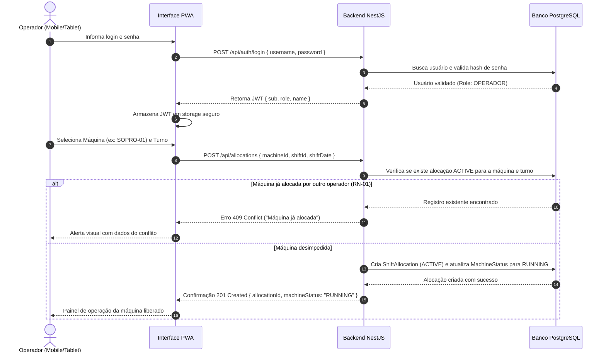
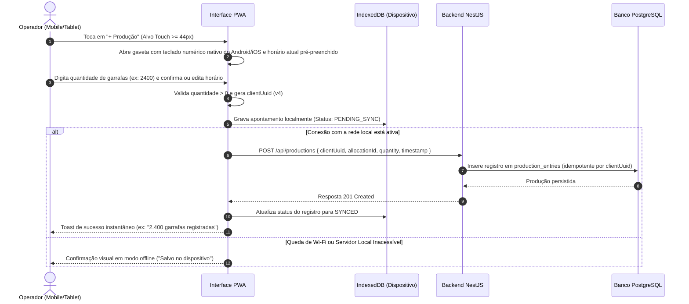
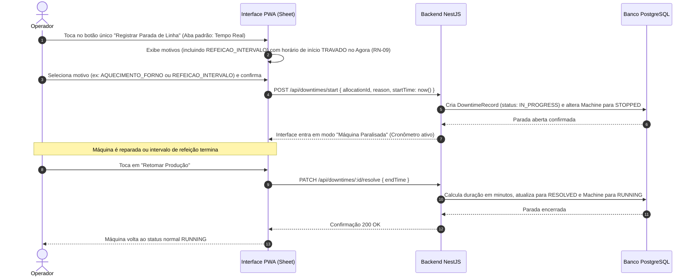
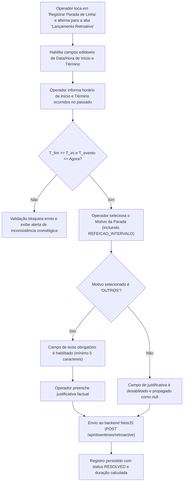
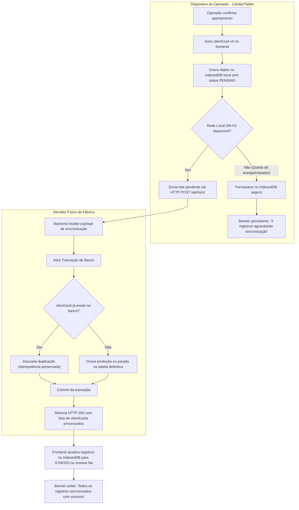
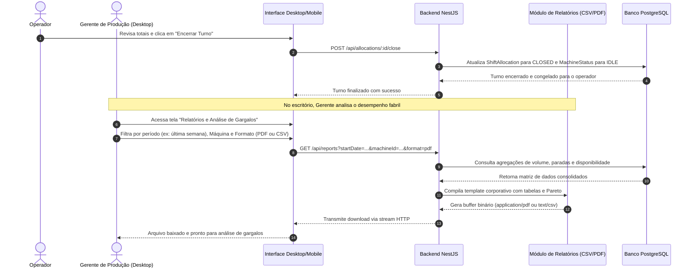

# SGMS — Sistema de Gestão de Máquinas de Sopro
## `docs/03-fluxos.md`

---

### 1. Fluxo de Autenticação e Alocação de Máquina no Turno

O operador acessa a interface no smartphone ou tablet e vincula sua sessão à máquina de sopro no início da jornada:

---

### 2. Fluxo de Apontamento Rápido de Produção (Touch em Chão de Fábrica)

O operador aponta o volume de garrafas sopradas na hora em que desejar ou de hora em hora para monitoramento de ritmo:

---

### 3. Fluxo de Apontamento de Paradas de Máquina (Gatilho Único no Console)

O Console Operacional possui um **único botão de ação para paradas** (`"Registrar Parada de Linha"`), eliminando botões secundários redundantes na tela principal. Ao tocar nele, abre-se o painel `Sheet` com duas abas: **Tempo Real (Agora)** e **Lançamento Retroativo**.

#### 3.1 Aba "Tempo Real (Agora)" (Horário Travado e Fechamento Posterior)

#### 3.2 Aba "Lançamento Retroativo" (Lançamento de Evento Passado com Início e Fim Editáveis)

---

### 4. Fluxo de Resiliência a Queda de Energia e Sincronização Offline (PWA)

O ciclo abaixo garante zero perda de dados em quedas de rede local:

---

### 5. Fluxo de Fechamento de Turno e Geração de Relatórios (Gerência)

