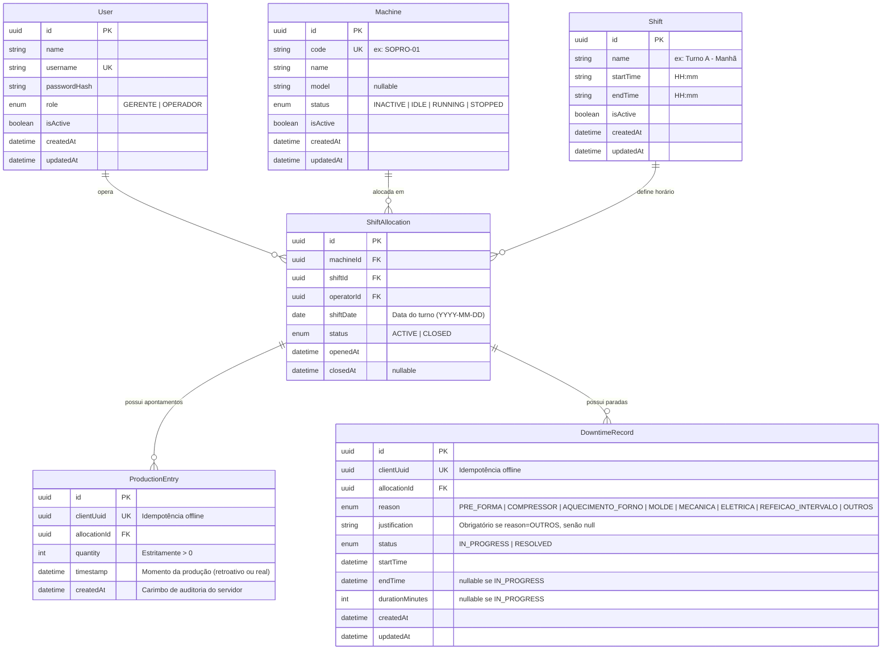

# SGMS — Sistema de Gestão de Máquinas de Sopro
## `docs/04-modelo-de-dados.md`

---

### 1. Diagrama Entidade-Relacionamento (ERD)



---

### 2. Dicionário de Tabelas e Atributos

#### 2.1 Tabela `users` (Contas e Autenticação)
Armazena operadores e gerentes com credenciais criptografadas.

| Campo | Tipo PostgreSQL | Nulo | Default | Descrição & Constraints |
| :--- | :--- | :--- | :--- | :--- |
| `id` | `UUID` | Não | `gen_random_uuid()` | Chave primária. |
| `name` | `VARCHAR(120)` | Não | - | Nome completo do colaborador. |
| `username` | `VARCHAR(50)` | Não | - | Login único para autenticação (`UNIQUE`). |
| `passwordHash`| `VARCHAR(255)` | Não | - | Hash de senha criptografada (Argon2id ou Bcrypt). |
| `role` | `VARCHAR(20)` | Não | - | Perfil de acesso: `'GERENTE'` ou `'OPERADOR'`. |
| `isActive` | `BOOLEAN` | Não | `true` | Controle de acesso lógico. |
| `createdAt` | `TIMESTAMPTZ` | Não | `NOW()` | Data de criação do usuário. |
| `updatedAt` | `TIMESTAMPTZ` | Não | `NOW()` | Data da última alteração. |

#### 2.2 Tabela `machines` (Parque de Máquinas de Sopro)
Registra as sopradoras industriais da fábrica.

| Campo | Tipo PostgreSQL | Nulo | Default | Descrição & Constraints |
| :--- | :--- | :--- | :--- | :--- |
| `id` | `UUID` | Não | `gen_random_uuid()` | Chave primária. |
| `code` | `VARCHAR(30)` | Não | - | Código fabril único da sopradora (`UNIQUE`, ex: `SOPRO-01`). |
| `name` | `VARCHAR(100)` | Não | - | Nome amigável de exibição. |
| `model` | `VARCHAR(100)` | Sim | `NULL` | Modelo técnico do fabricante (propaga `NULL` se ausente). |
| `status` | `VARCHAR(20)` | Não | `'IDLE'` | Status atual: `'INACTIVE'`, `'IDLE'`, `'RUNNING'`, `'STOPPED'`. |
| `isActive` | `BOOLEAN` | Não | `true` | Ativação lógica da máquina no parque fabril. |
| `createdAt` | `TIMESTAMPTZ` | Não | `NOW()` | Registro inicial no sistema. |
| `updatedAt` | `TIMESTAMPTZ` | Não | `NOW()` | Última atualização de status. |

#### 2.3 Tabela `shifts` (Turnos de Trabalho)
Configuração dos turnos de produção cadastrados pelo Gerente.

| Campo | Tipo PostgreSQL | Nulo | Default | Descrição & Constraints |
| :--- | :--- | :--- | :--- | :--- |
| `id` | `UUID` | Não | `gen_random_uuid()` | Chave primária. |
| `name` | `VARCHAR(60)` | Não | - | Nome identificador do turno (ex: `Turno 1 - Manhã`). |
| `startTime` | `VARCHAR(5)` | Não | - | Horário planejado de início no formato `HH:mm` (ex: `06:00`). |
| `endTime` | `VARCHAR(5)` | Não | - | Horário planejado de término no formato `HH:mm` (ex: `14:00`). |
| `isActive` | `BOOLEAN` | Não | `true` | Turno ativo para novas alocações. |
| `createdAt` | `TIMESTAMPTZ` | Não | `NOW()` | Data de cadastro. |
| `updatedAt` | `TIMESTAMPTZ` | Não | `NOW()` | Data de alteração. |

#### 2.4 Tabela `shift_allocations` (Alocação Exclusiva Máquina-Turno)
Representa a posse de uma sopradora por um operador específico durante um turno.

| Campo | Tipo PostgreSQL | Nulo | Default | Descrição & Constraints |
| :--- | :--- | :--- | :--- | :--- |
| `id` | `UUID` | Não | `gen_random_uuid()` | Chave primária. |
| `machineId` | `UUID` | Não | - | Chave estrangeira referenciando `machines(id)`. |
| `shiftId` | `UUID` | Não | - | Chave estrangeira referenciando `shifts(id)`. |
| `operatorId` | `UUID` | Não | - | Chave estrangeira referenciando `users(id)`. |
| `shiftDate` | `DATE` | Não | - | Data operacional da produção (`YYYY-MM-DD`). |
| `status` | `VARCHAR(20)` | Não | `'ACTIVE'` | `'ACTIVE'` ou `'CLOSED'`. |
| `openedAt` | `TIMESTAMPTZ` | Não | `NOW()` | Horário real de abertura da jornada pelo operador. |
| `closedAt` | `TIMESTAMPTZ` | Sim | `NULL` | Horário de fechamento formal (`NULL` enquanto ativo). |

- **Constraint de Integridade Inegociável (RN-01):**
  Índice único condicional que impede alocação duplicada de uma máquina no mesmo turno enquanto estiver ativa:
  ```sql
  CREATE UNIQUE INDEX "idx_unique_active_machine_shift" 
  ON "shift_allocations" ("machineId", "shiftId", "shiftDate") 
  WHERE "status" = 'ACTIVE';
  ```

#### 2.5 Tabela `production_entries` (Apontamentos de Garrafas)
Lançamentos de contagem de garrafas sopradas no turno.

| Campo | Tipo PostgreSQL | Nulo | Default | Descrição & Constraints |
| :--- | :--- | :--- | :--- | :--- |
| `id` | `UUID` | Não | `gen_random_uuid()` | Chave primária. |
| `clientUuid` | `UUID` | Não | - | UUID gerado no frontend/IndexedDB para idempotência (`UNIQUE`). |
| `allocationId`| `UUID` | Não | - | Chave estrangeira referenciando `shift_allocations(id)`. |
| `quantity` | `INTEGER` | Não | - | Total de garrafas sopradas no apontamento (`CHECK (quantity > 0)`). |
| `timestamp` | `TIMESTAMPTZ` | Não | - | Momento do apontamento (editável para lançamentos retroativos). |
| `createdAt` | `TIMESTAMPTZ` | Não | `NOW()` | Auditoria de inserção real no banco. |

#### 2.6 Tabela `downtime_records` (Ocorrências de Paradas)
Registro detalhado de interrupções de sopro e seus motivos.

| Campo | Tipo PostgreSQL | Nulo | Default | Descrição & Constraints |
| :--- | :--- | :--- | :--- | :--- |
| `id` | `UUID` | Não | `gen_random_uuid()` | Chave primária. |
| `clientUuid` | `UUID` | Não | - | UUID gerado no frontend/IndexedDB para idempotência (`UNIQUE`). |
| `allocationId`| `UUID` | Não | - | Chave estrangeira referenciando `shift_allocations(id)`. |
| `reason` | `VARCHAR(30)` | Não | - | Motivo padronizado (`PRE_FORMA`, `COMPRESSOR`, etc). |
| `justification`| `VARCHAR(255)`| Sim | `NULL` | Obrigatório se `reason = 'OUTROS'`, senão `NULL`. |
| `status` | `VARCHAR(20)` | Não | - | `'IN_PROGRESS'` ou `'RESOLVED'`. |
| `startTime` | `TIMESTAMPTZ` | Não | - | Momento de início da parada (retroativo ou real). |
| `endTime` | `TIMESTAMPTZ` | Sim | `NULL` | Momento de término (`NULL` se `IN_PROGRESS`). |
| `durationMinutes`| `INTEGER` | Sim | `NULL` | Duração calculada em minutos (`CHECK (durationMinutes >= 0)`). |
| `createdAt` | `TIMESTAMPTZ` | Não | `NOW()` | Auditoria de inserção. |
| `updatedAt` | `TIMESTAMPTZ` | Não | `NOW()` | Auditoria de atualização/resolução. |

---

### 3. Schema Oficial Prisma ORM (`prisma/schema.prisma`)

```prisma
datasource db {
  provider = "postgresql"
  url      = env("DATABASE_URL")
}

generator client {
  provider = "prisma-client-js"
}

enum UserRole {
  GERENTE
  OPERADOR
}

enum MachineStatus {
  INACTIVE
  IDLE
  RUNNING
  STOPPED
}

enum ShiftAllocationStatus {
  ACTIVE
  CLOSED
}

enum DowntimeReason {
  PRE_FORMA
  COMPRESSOR
  AQUECIMENTO_FORNO
  MOLDE
  MECANICA
  ELETRICA
  REFEICAO_INTERVALO
  OUTROS
}

enum DowntimeStatus {
  IN_PROGRESS
  RESOLVED
}

model User {
  id           String            @id @default(uuid()) @db.Uuid
  name         String            @db.VarChar(120)
  username     String            @unique @db.VarChar(50)
  passwordHash String            @db.VarChar(255)
  role         UserRole
  isActive     Boolean           @default(true)
  createdAt    DateTime          @default(now()) @db.Timestamptz
  updatedAt    DateTime          @updatedAt @db.Timestamptz
  allocations  ShiftAllocation[]

  @@map("users")
}

model Machine {
  id          String            @id @default(uuid()) @db.Uuid
  code        String            @unique @db.VarChar(30)
  name        String            @db.VarChar(100)
  model       String?           @db.VarChar(100)
  status      MachineStatus     @default(IDLE)
  isActive    Boolean           @default(true)
  createdAt   DateTime          @default(now()) @db.Timestamptz
  updatedAt   DateTime          @updatedAt @db.Timestamptz
  allocations ShiftAllocation[]

  @@map("machines")
}

model Shift {
  id          String            @id @default(uuid()) @db.Uuid
  name        String            @db.VarChar(60)
  startTime   String            @db.VarChar(5)
  endTime     String            @db.VarChar(5)
  isActive    Boolean           @default(true)
  createdAt   DateTime          @default(now()) @db.Timestamptz
  updatedAt   DateTime          @updatedAt @db.Timestamptz
  allocations ShiftAllocation[]

  @@map("shifts")
}

model ShiftAllocation {
  id          String                @id @default(uuid()) @db.Uuid
  machineId   String                @db.Uuid
  shiftId     String                @db.Uuid
  operatorId  String                @db.Uuid
  shiftDate   DateTime              @db.Date
  status      ShiftAllocationStatus @default(ACTIVE)
  openedAt    DateTime              @default(now()) @db.Timestamptz
  closedAt    DateTime?             @db.Timestamptz

  machine     Machine               @relation(fields: [machineId], references: [id])
  shift       Shift                 @relation(fields: [shiftId], references: [id])
  operator    User                  @relation(fields: [operatorId], references: [id])
  productions ProductionEntry[]
  downtimes   DowntimeRecord[]

  @@index([machineId, shiftDate])
  @@index([operatorId, shiftDate])
  @@map("shift_allocations")
}

model ProductionEntry {
  id           String          @id @default(uuid()) @db.Uuid
  clientUuid   String          @unique @db.Uuid
  allocationId String          @db.Uuid
  quantity     Int
  timestamp    DateTime        @db.Timestamptz
  createdAt    DateTime        @default(now()) @db.Timestamptz

  allocation   ShiftAllocation @relation(fields: [allocationId], references: [id])

  @@index([allocationId, timestamp])
  @@map("production_entries")
}

model DowntimeRecord {
  id              String          @id @default(uuid()) @db.Uuid
  clientUuid      String          @unique @db.Uuid
  allocationId    String          @db.Uuid
  reason          DowntimeReason
  justification   String?         @db.VarChar(255)
  status          DowntimeStatus
  startTime       DateTime        @db.Timestamptz
  endTime         DateTime?       @db.Timestamptz
  durationMinutes Int?
  createdAt       DateTime        @default(now()) @db.Timestamptz
  updatedAt       DateTime        @updatedAt @db.Timestamptz

  allocation      ShiftAllocation @relation(fields: [allocationId], references: [id])

  @@index([allocationId, reason])
  @@index([startTime, endTime])
  @@map("downtime_records")
}
```

---

### 4. Índices Estratégicos para Relatórios e Consultas Rápidas na LAN

1. `production_entries (allocationId, timestamp)`: Otimiza cálculo de ritmo e agregação horária por alocação.
2. `downtime_records (allocationId, reason)`: Otimiza agrupamento para o gráfico de Pareto de paradas.
3. `downtime_records (startTime, endTime)`: Acelera filtros por intervalo de datas para relatórios gerenciais em PDF e CSV.
4. `shift_allocations (machineId, shiftDate)`: Permite consulta instantânea do histórico operacional de qualquer sopradora.
